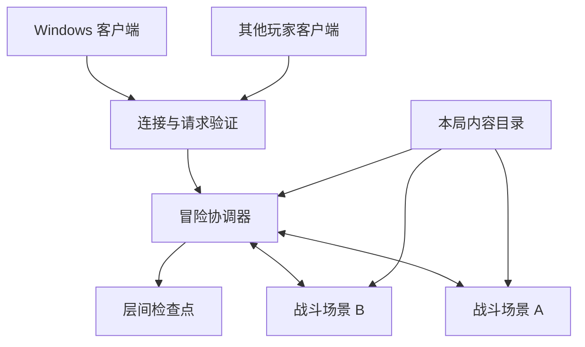
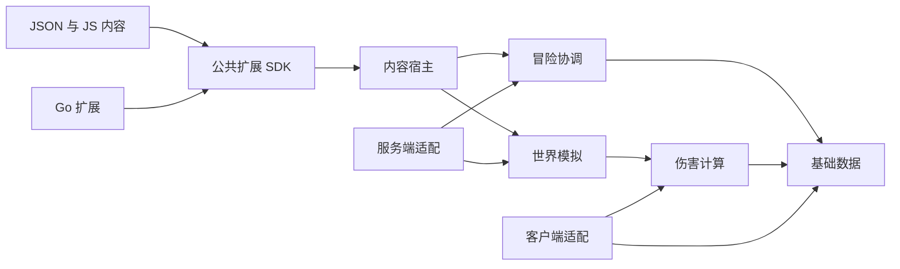
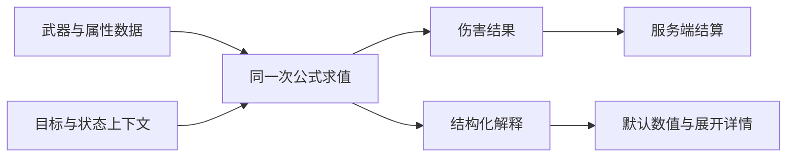
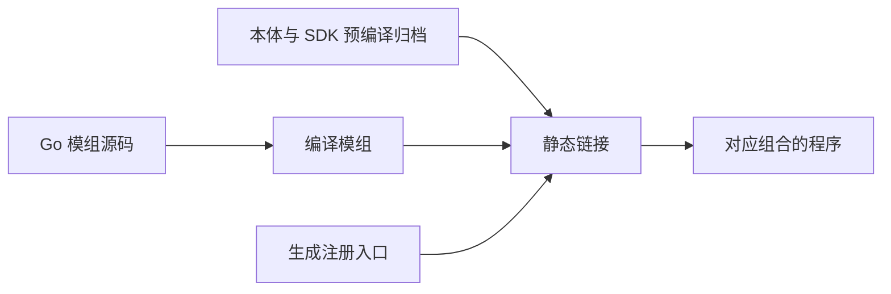

# 局部显现 / Local Manifestation 基础架构方案

更新日期：2026 年 10 月 8 日。

《局部显现》（Local Manifestation）面向低收费买断制发行，公开游戏、SDK 和工具源码。架构采用 Go 客户端和独立服务端，Go 承担模拟与基础系统，JS 和 JSON 定义原版及扩展内容。第一个可玩版本覆盖完整多层冒险循环，使用占位美术，先在本机与局域网验证，再完成公网部署。

[已确认设计](design.md)记录产品约束。工程已按本文开始实现，已落地部分与待实现范围见[开发指南](development.md)。本文仍描述完整目标，不能视为所有能力已经完成。

## 产品边界与交付目标

| 项目 | 已确认范围 |
| --- | --- |
| 玩家端 | 首版 Windows 可下载桌面客户端 |
| 服务端 | Windows 和 Linux 独立无界面程序 |
| 联机组织 | 一个进程承载一个联机房间，单人可开局，默认上限 8 人，配置可扩展 |
| 同局并发 | 多个战斗场景同时运行，成员可以分别进入 |
| 裁定 | 服务端处理玩法结果，客户端处理输入与表现 |
| 世界与镜头 | 共用世界坐标，客户端切换俯视和斜俯视 |
| 内容制作 | Go 引擎，JSON 数据，JS 原版与模组行为，Go 复杂扩展 |
| 本地化 | 独立的标准 JSON 语言包，默认中文和英文，客户端切换与保存 |
| 发布与源码 | 低收费买断制，全部源码公开，统一主仓库 |
| 第一个可玩版本 | 完整多层探索、成长、战斗、BOSS、结算与恢复循环 |

价格、开源许可证、发行渠道和正式美术方向在发布方案中确定。账号服务、匹配大厅和云存档不属于当前已定范围。

## 进程组成

客户端连接独立服务端。玩家在自己电脑开服时，客户端可以启动独立的服务端进程，房主具有管理员权限；远程部署时由服务器管理员配置。客户端通过地址与端口连接。

一个服务端进程对应一个联机房间和一套启用的内容组合。这个房间内的战略地图与多个战斗场景属于同一次冒险。承载多个联机房间时运行多个进程；同一冒险中的战斗场景由一个服务端统一协调。



服务端发送状态快照和事实事件，客户端据此显示位置、动作和结果。当前使用带序号的 TCP/JSON 请求及协议 8 快照，快照默认 20 Hz，客户端缓冲位置历史并插值。本机普通移动已接入即时显示预测和服务端校正，其他实体继续插值；进一步传输优化留待对应阶段。架构以服务端结果同步为基础，不要求两端逐帧运行相同的内容脚本。

## 技术组件

| 部分 | 技术方案 | 职责边界 |
| --- | --- | --- |
| 窗口与渲染 | Ebitengine | 只在客户端依赖图出现 |
| 世界模拟与基础系统 | Go | 独立于窗口和脚本对象 |
| JS 运行时 | 优先验证 goja | 经适配器接入，SDK 不暴露运行时专用类型 |
| 内容定义 | 标准 JSON | 下划线字段承载注释，其他字段按结构验证 |
| Go 扩展 | 包归档与静态链接 | 锁定工具链和平台，需要链接及重启 |
| 校验 | SHA-256 | 必需包按整个 ZIP 摘要匹配 |
| 保存 | 版本化数据结构 | 不保存虚拟机、函数指针或图形对象 |

Ebitengine 支持 Windows 的图形、键鼠输入和音频。当前安装文档要求 Go 1.25 或以上，并说明桌面构建使用纯 Go。图形依赖需要与无界面服务端分开。[功能文档](https://ebitengine.org/en/documents/features.html)、[安装文档](https://ebitengine.org/en/documents/install.html)

goja 是纯 Go 的 JS 运行时，当前最低 Go 版本为 1.25，支持 ECMAScript 5.1 及部分后续特性。一个 Runtime 同时只能由一个 goroutine 使用，运行时之间不能传递 JS 对象。Node.js 功能和定时器环境需要宿主另外提供，脚本能力以游戏 SDK 为准。[goja 文档](https://github.com/dop251/goja)

工程已锁定 Go 1.26.8、Ebitengine 2.10.4 与 goja 提交版本，记录在 `go.mod`、`go.sum`。图形渲染与 JS 适配器分别接入，无界面服务端不依赖 Ebitengine。

客户端 UI 的纯几何核心位于 `internal/client/ui`：锚点布局、可见范围限制、命中顺序与拖动候选返回独立值，不依赖 Ebitengine、网络或文件。`internal/client` 拥有焦点、窗口顺序和编辑草稿，在 Update 中组合快照与控件值，先消费 UI 输入，再产生游戏意图；Draw 读取这些值。配置宿主完整校验后以文件替换提交语言、绑定及布局，保存失败不修改已提交偏好。伤害详情复用数值解释，按快照/语言失效并缓存换行，避免渲染帧内完整求值。详见[原生 UI 实现记录](history/ui-stage.md)。

`pkg/geometry` 提供房间正六边形顶点、带半径的边界约束、线段裁剪、六边形网格及分散出生点，服务端与客户端共用。非战斗玩家由冒险协调器持有并按固定刻移动；进入战斗后由场景 actor 持有，协调器停止写入其坐标。客户端从已裁定坐标构造非战斗空间显示和插值，静态房间网格按尺寸/视角/窗口缓存批量绘制。实际入口按共享纯几何进行服务端校验，付费事务和 actor 交接由协调器串行提交；客户端缓存当前和周围一圈房间的局部纹理，普通移动使用独立显示预测。见[跨房实现](history/doors-stage.md)。

## Go 与 JS 的职责

Go 负责世界坐标、移动和碰撞、实体生命周期、伤害求值、属性与状态基础设施、装备和物品状态、行动力事务、网络裁定、保存和并发调度。JS 定义敌人决策、技能与物品行为、事件节点和关卡流程，通过 SDK 提交动作或规则扩展。

原版内容与模组使用同一套注册、查询、指令和事件接口。原版内容通过 SDK 操作引擎，使扩展接口在日常开发中持续接受验证。

内容脚本表达发射投射物、施加状态、注册乘区、选择敌人及推进内容流程等行为，Go 系统执行模拟和计算。具体可编程范围及完整 API 在内容运行时模块实现前明确。

脚本时间、随机数、查询和异步等待由宿主上下文提供，接入游戏逻辑时间和服务端状态。脚本不直接取得可变世界指针、渲染引擎对象或 Go goroutine 的控制权。

公共、服务端和客户端入口分别注册。服务端入口执行玩法，客户端入口执行表现，公共入口建立两端需要的数据定义。进入两端构建的 Go 模组通过 SDK 接入客户端表现能力，服务端依赖图继续保持无图形初始化依赖。

## 单仓库模块方案

以下目录表示目标职责边界。客户端、服务端、模组工具、协调器、场景、内容、脚本、检查点、公共数据、伤害、协议与 SDK 已建立；完整本地进度和其他内容系统仍需逐步落实。

```text
HSMutiplayer/
  cmd/
    client/                 客户端入口
    server/                 独立服务端入口
    modtool/                模组打包 校验 构建入口
  internal/
    client/                 输入 渲染 界面 本地服务端启动
    server/                 连接 身份 会话 管理员操作
    session/                冒险 地图 行动力 团队决策 层推进
    scene/                  战斗场景 实体 模拟 调度
    content/                内容目录 依赖 注册 包加载 资源索引
    script/                 JS 宿主与 SDK 绑定
    persistence/            检查点及结算持久化
    profile/                本地进度 仓库 身份及本局加成输入
  pkg/
    model/                  基础值类型和可交换数据
    status/                 纯值状态层与生命周期核心
    damage/                 可复用数值求值与解释
    stats/                  带来源的派生属性与解释
    timing/                 固定步长 补刻 绘制节奏与实测频率
    protocol/               两端数据契约
  sdk/                      扩展注册 查询 指令 事件接口
  content/
    base/                   原版 JSON JS 与占位资源
  tools/                    工程构建 分发 资源处理工具
  docs/                     设计 架构 SDK 及部署说明
```

SDK 不导入 `internal` 实现、渲染引擎或脚本虚拟机类型。`pkg/damage` 可以依赖基础值类型，但不依赖网络、保存、窗口或内容宿主。协议只描述可传输的意图与结果，不把内部世界对象暴露给客户端。

客户端与服务端分别组装所需依赖。SDK 可以在主仓库中独立版本化；公开导入路径在仓库地址确定后设置。



图中箭头表示调用或数据使用方向。SDK 定义契约，宿主提供实现；SDK 包本身不反向导入宿主。

## 状态所有权与并发

冒险协调器持有团队地图、行动力、团队决策、人员资格、场景归属和层推进状态。每个战斗场景持有实体、投射物、碰撞、战斗状态和场景脚本上下文。

每份可变状态只有一个修改者。同一玩家在任一时刻只有一个活动状态归属；进入、退出和支援由协调器迁移状态与控制资格，不能让两个场景同时修改一个玩家。装备、物品和属性变动通过对应所有者提交，场景之间不共享可变指针。

| 工作 | 并发组织 |
| --- | --- |
| 网络读写 | 独立 I/O，转换为带身份与序号的请求 |
| 团队地图与行动力 | 协调器串行处理相关事务 |
| 不同战斗场景 | 独立模拟，可在不同 goroutine 运行 |
| 同一战斗场景 | 按逻辑更新顺序处理命令和事件 |
| JS Runtime | 与所属协调器或场景串行绑定 |
| 文件与资源处理 | 后台完成工作，再交回所有者发布结果 |

JS 上下文按协调器或场景隔离，交换 Go 数据与命令。一个场景内的内容按明确顺序调度，事件广播尊重接收者的状态所有权。

层间保存与 BOSS 集结需要协调边界：协调器取得各场景明确的状态和结算结果后，再提交全局转换。已确认的暂停、救援和未完成结算由这个边界承载，具体转换条件在相关模块实现前整理。

种子驱动地图与内容随机选择，随机状态作为可保存的数据管理。服务端结果是联机一致性的依据，完整战斗回放和逐帧确定性尚未列为项目目标。

### 逻辑刻、网络同步与渲染帧

服务端世界使用固定步长，以配置的 30 或 60 次/秒推进。网络快照发布频率和客户端绘制帧率分别配置，渲染上限不改变服务端逻辑步长。伤害、移动、冷却、状态与冒险逻辑时间由宿主逻辑刻推进，不能由 `Draw` 调用次数推进。

客户端维护带场景身份、逻辑刻及时间信息的快照历史，在独立渲染时刻求取显示位置。插值只影响显示，目标状态、生命和事件仍使用服务端结果；跨房、传送、生成/消失及暂停边界需要明确的历史重置或切换。俯视与斜俯视投影使用同一份显示世界坐标。

Ebitengine 的 `Update` 与 `Draw` 可使用不同频率，但回调仍由同一 goroutine 调用。服务端已是独立进程；客户端 `Update` 负责输入和消息处理，不承担权威世界模拟。FPS 上限由绘制调度实现，不能使用 `SyncWithFPS` 将玩法逻辑绑定到绘制。参见 [Ebitengine API](https://pkg.go.dev/github.com/hajimehoshi/ebiten/v2#RunGameWithOptions)。

验收分别测量服务端实际 TPS、客户端 FPS、输入发送频率和快照接收频率；切换渲染上限时，固定逻辑步长和同样逻辑刻数对应的玩法结果应保持一致。实现顺序和当前不足见[第二批实现方案](history/next-stage.md)。

## 冒险与战斗场景

一次冒险连接管理员配置与成员准备、层初始化、地图探索与并行节点、BOSS 结算、层间准备、下一层，最终进入通关或失败结算。层数及各层内容通过定义提供。

战略节点定义与访问实例分开。定义描述内容与参与条件，实例保存本次参与、支付、收益和完成状态。战斗场景对应访问实例，同一冒险可以同时持有多个实例。

已确认空间方案为独立房间与实际跨房入口。连接区域同样是可行走的完整六边形房间，以“通路”“野外”等命名且进入不消耗行动力；无房间格显示“悬崖”“山壁”等地形。空间模拟生命周期与战斗生命周期分开，大地图不执行玩家位置转换。全屏 HUD 的布局配置独立于权威世界坐标，完整新增边界见[HUD 与跨房移动](history/hud-navigation.md)。上述基础空间、物理入口、周边加载与实体装置已接入；障碍导航及正式状态等仍待后续阶段。

共享行动力归零解锁强化 BOSS 选项，个人探索和救援可以继续。实际进入 BOSS、处理暂停实例和结束本层属于全局转换；可进入、已入场和完成战斗分别表达。

初始行动力、本局允许的局外输入和本层地图由层初始化产生。成员加入及旧角色恢复在允许的准备阶段进行，临时重连恢复已有连接资格，不创建第二个角色。

## 伤害计算与可复用解释

`pkg/damage` 接收攻击、属性、目标防御和规则上下文，返回数值结果及结构化解释。预览、命中结算、装备比较和调试复用求值逻辑，界面只将解释转换为简略或展开显示。

解释包含运算类型、输入、输出、来源、乘区身份、伤害类型和上下文。来源使用稳定内容 ID，展示文本不另外维护一套公式。



预览标明假设，客户端可以用已知数据计算；实际命中和目标减伤由服务端确认。未知目标信息及随机条件不能在预览中表现为已发生的结果。

多类型伤害使用多个结算段，命中身份和伤害段身份分开。命中触发按命中事件处理，伤害后处理读取实际生命扣除及护盾吸收；追加伤害不自动创建新命中。

JS 内容提供可交换的公式定义、命名乘区及来源信息，Go 扩展可以注册新的运算类型，并提供求值语义和解释数据。脚本条件先由宿主转换为计算上下文，核心求值不持有 JS 对象或虚拟机，保持计算与展示模块可独立复用。完整公式替换不作为优先支持的公共路径。数值类型、舍入实现及具体 API 在伤害模块编码前确定。

## 视角与输入

战略六边形坐标用于节点和路径，战斗场景坐标用于连续移动和碰撞。客户端的两种镜头共享同一场景坐标，投影层将世界位置转为画面，并将鼠标位置反向映射为世界目标。

视角切换不改变距离、碰撞和攻击规则。实体在不同投影中可以采用不同的绘制与深度排序；正式动画、高度表现和资源规范在渲染模块实施前讨论。

输入层把键盘、鼠标移动、攻击、技能、闪避和消耗品整理为意图。客户端寻路提供移动建议，服务端验证合法移动。按键模式和镜头选择不会改变服务端战斗规则。

## 内容注册与事件

内容目录保存实体、武器、护甲、饰品、技能、状态、节点和关卡定义；运行实例引用内容 ID 并保存本次状态。补丁和覆盖使用显式目标与加载顺序。

依赖决定必须的先后关系，玩家优先级只调整没有依赖约束的顺序。内容使用模组命名空间，防止偶然同名形成隐式覆盖。

引擎接收命令、验证条件、修改状态，再发布事实事件。监听器取得数据，后续操作重新提交命令。影响公式和规则的扩展使用专门入口，避免监听顺序隐式改变中间值。

内部事实事件与装备触发条件分开。提供伤害结果供界面或恢复类效果读取，不等于新增通用的造成伤害触发条件。原版与模组遵守已经确认的命中和伤害后处理契约。

该阶段确定注册与调度边界，完整事件列表、状态系统和具体内容在对应模块实现前整理。

## 模组构建与加载

开发者可以从公开源码构建。面向玩家的工具使用分离路线：官方提供对应平台的本体、SDK 和必要依赖归档，工具编译 Go 模组与注册入口，最后静态链接对应程序。Go 模组编入两端，其执行由公共、服务端及客户端入口区分。



Go 编译器可以读取归档中的类型信息，链接器组合入口及其依赖。分离路线需要专用构建流程，不能依赖已移除的旧式 binary-only package 支持，归档也不保证跨 Go 版本二进制兼容。[编译器文档](https://pkg.go.dev/cmd/compile)、[链接器文档](https://pkg.go.dev/cmd/link)、[Go 兼容性说明](https://go.dev/doc/go1compat)、[Go 1.13 说明](https://go.dev/doc/go1.13#go-command)

纯 Go 的 Windows 实验验证了基础分离编译。完整图形客户端、JS 运行时、多模组及 Linux 服务端仍需要集成验证，之后才能将此流程用于发行构建。

作者在模组清单声明兼容范围，组合锁定精确版本、来源摘要、工具链和构建参数。优先复用满足范围的既有锁定版本，没有共同候选则显示冲突并保留原可用组合。本体归档的依赖版本属于硬约束。

`go.mod` 的 `require` 表达最低版本要求，上限等范围由模组工具额外解析及验证。随包提供的纯 Go 依赖保留可识别版本和来源。[Go 模块规则](https://go.dev/ref/mod#require-directive)

包身份为整个 ZIP 的 SHA-256。实际读取内容必须属于已验证的包，本地修改后重新打包才能生成新的身份。客户端核对必需包、版本、加载顺序、摘要和组合设置，下载缺失包；含 Go 时由玩家手动构建，再重启连接。

个人界面、外观和材质包在本地验证，只作用于表现。它们继续遵守 SDK 和必需包同步边界。本地可执行文件校验与内容组合身份分别管理，不要求不同平台程序字节相同。

## 热重载与加载速度

每次冒险固定内容目录、版本、资源映射和规则配置，整局禁止重载，包括层间准备。局外重载先构建新目录，验证结构、依赖、脚本注册和资源后再发布，失败时保留原目录。

含 Go 的混合包不能热重载。代码及构建依赖变化需要构建、链接和重启；只改变外部 JSON 或资源时重启即可复用程序。其他包支持单局外重载。

缓存分别服务于摘要验证、数据解析、脚本编译、资源解码和归档构建，键包含内容摘要及对应版本。JS Runtime、事件监听和场景实例按上下文建立、释放，不作为下一局内容缓存。

加载耗时分别记录包扫描、验证、解析、注册、资源和构建阶段。缓存格式、预加载范围与性能预算结合实施时的实测确定。

## 保存与本地进度

服务端在层间准备完成、进入下一层前保存检查点。保存冒险数据、角色记录、内容组合、地图、随机状态、层配置和结算信息，不保存 goroutine、JS 对象或图形资源。

检查点由管理员选择、恢复和导出；玩家本地持有身份、成长、仓库和结算记录。服务器依据整局固定的限制应用局外输入，恢复严格匹配原模组版本、顺序及 ZIP 摘要。

恢复不等待原班队伍。未回归旧角色的记录保留至允许的层间回归阶段；本层开局前已确认的成员临时掉线仍可以重连。新成员采用已确认的当前层预设补偿。

冒险拥有稳定身份，种子与开始时间参与生成标识。每玩家的结算记录及仓库更新构成去重边界；具体复制防护、编码和事务在保存模块实施前处理，摘要本身不能阻止文件复制。

保存格式、协议、SDK、内容定义和构建组合分别带版本，保留后续迁移入口。实际兼容策略在实现前确定，不能因此放宽已确认的模组匹配要求。

## 开发顺序与完整版本验收

开发按依赖顺序推进，每阶段形成内部验证结果。第一个对外可玩里程碑以完整多层冒险循环验收。

| 顺序 | 工作 | 阶段完成条件 |
| --- | --- | --- |
| 1 | 基础架构审阅 | 职责 依赖方向 交付范围可进入编码 |
| 2 | 工程与内容基础 | 两端入口 公共数据 SDK JSON 与 JS 加载可验证 |
| 3 | 战斗与数值 | Go 模拟 伤害解释 状态及双视角共同验证 |
| 4 | 联机与并行场景 | 至少两台设备联机 不同场景并发及团队事务一致 |
| 5 | 完整冒险 | 多层地图 成长 普通与强化 BOSS 救援 通关及失败连接起来 |
| 6 | 扩展与保存 | 原版使用 SDK 扩展 校验 分离构建 层间恢复可验证 |
| 7 | 可玩版本与公开访问 | 完整循环 规则说明 Windows 分发 跨网络访问验证完成 |

完整版本覆盖已确认的成长来源、不同初始机体、武器与技能倾向、护甲、饰品、状态、敌人和节点模板，内容数量在实施前确定。伤害详情可以展开，节点提示和操作说明足以让玩家独立理解基本规则。

关键验证包括两端结果一致、不同场景不重复消费、镜头不改变世界结果、数值与解释一致、BOSS 路线正确、检查点不重复结算、包不匹配被识别及表现扩展不影响玩法裁定。

性能评估覆盖多个战斗场景、Go 与 JS 调用、伤害解释、加载和网络输出。使用剖析及集成验证确定优化点，当前不承诺未测量的帧率、同步频率或高于原生人数的容量。

## 现有实验的处理

现有 `pkg/expedition` 是早期行动力实验，部分状态转换与后续讨论不同。原子消费和独立于渲染的思路可供参考，正式冒险协调器按最新规则重新组织。

工程初始化与可运行开发流程已经完成，正式入口使用新的协调器。旧实验不参与客户端与服务端运行，后续按需要迁移或清理。

当前增量采用独立冒险整数时钟，每秒 60000 单位，协调器向实体所属 actor 串行传递时间。普通等待和波次间不暂停玩家；全员倒地的战斗暂停仍处理状态到期。连续免费入口使用共享格坐标变换，保留显示预测和持续移动。接口、预算与验收见[movement-status-stage.md](history/movement-status-stage.md)。

## 已接入的菜单与装置边界

主菜单进入本地可走动的个人大厅；大厅设施通过纯值装置与宿主动作启动/加入独立服务器，未开局时不驱动冒险时钟。`pkg/device` 统一世界位置、范围、显示及房间入口特化，`pkg/lobby` 校验已支持的服务器配置；客户端只拥有交互显示与本地配置，玩法仍交给服务端裁定。`pkg/life` 分离倒地事件记录与可移除惩罚，场景和协调器在各自所有权范围提交转换。当前版本和实际范围见[本批记录](history/device-hall-stage.md)。

Hover 随后拆为独立只读显示值，不进入窗口栈、拾取、拖动或布局保存；普通窗口继续支持多个并存。无动作入口只提供信息提示，连续跨房由原有服务端移动交接完成。最新修复与已批准内容缺口见[实现核对](implementation-audit.md)。迭代默认只编译和少量必要实机检查，并交付待测清单；全量行为、竞态与规模性能验收不再自动逐轮运行。
